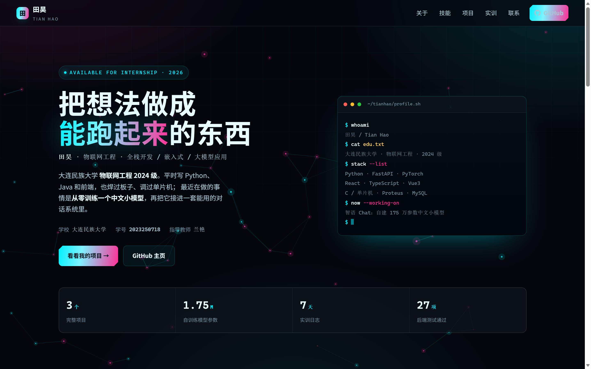

# 田昊 · 个人主页

大连民族大学 · 物联网工程 2024 级 · 全栈开发 / 嵌入式 / 大模型应用。

《软件开发综合实践》"个人网站开发与部署"任务交付物：**Vite + React 18 + TypeScript** 单页应用，组件化拆分、TypeScript 严格模式、构建后由 GitHub Pages 托管。

**线上地址**：<https://th-cell-source.github.io/personal-homepage/>



## 技术栈

| 层 | 选型 |
| --- | --- |
| 框架 | React 18（函数组件 + Hooks，`StrictMode`） |
| 语言 | TypeScript 5（`strict: true`、`noUnusedLocals`） |
| 构建 | Vite 5（`base: /personal-homepage/`） |
| 样式 | CSS 变量 + Grid/Flex + 媒体查询（无 CSS 框架） |
| 图形 | Canvas 2D（粒子背景） |
| 部署 | GitHub Pages（`main` 分支根目录） |

## 目录结构

```
personal-homepage/
├── app/                      # 源码根（Vite root）
│   ├── index.html            # 入口模板
│   └── src/
│       ├── main.tsx          # 挂载
│       ├── App.tsx           # 页面组装
│       ├── components/       # Nav / Hero / About / Skills / Projects / Journey / Contact / Footer / Backdrop / Reveal
│       ├── hooks/            # useParticles、useScrollProgress、useSectionSpy
│       ├── data/             # profile.ts：个人信息、技能、项目、时间线
│       └── styles/           # global.css：设计令牌与全部样式
├── scripts/copy-dist.mjs     # 构建产物拷到仓库根目录
├── index.html + assets/      # 已构建的发布产物（Pages 直接托管）
├── screenshots/              # 预览图
├── legacy/                   # 早期单文件 HTML 版本（留档）
└── PRD.md / TECH.md / AGENT.md / README.md
```

## 本地开发

```bash
npm install
npm run dev      # http://localhost:5174/personal-homepage/
```

## 构建与发布

```bash
npm run build          # tsc --noEmit && vite build → dist/
npm run publish:pages  # 构建并把 dist/ 拷到仓库根目录
git add -A && git commit -m "..." && git push
```

推送到 `main` 后 GitHub Pages（main / root）约 1 分钟自动生效。

## 页面结构

| 区块 | 内容 |
| --- | --- |
| 导航 | 固定毛玻璃条，滚动高亮当前区块，移动端折叠菜单 |
| 首屏 | 一句话主张 + 姓名/专业/方向 + 学校学号 + 两个 CTA + 终端名片 |
| 数据条 | 项目数 / 自训练模型参数 / 实训天数 / 后端测试项 |
| 关于我 | 三段介绍 + 七项事实清单 |
| 技能栈 | 后端、前端、AI 大模型、嵌入式四组标签 |
| 项目作品 | 智语 Chat、电商图片下载助手、本站 |
| 实训历程 | 10-20 ~ 10-28 七天时间线 |
| 训练文件 | 训练链路、三阶段指标与损失曲线、8 个脚本源码在线查看 |
| 联系 | GitHub / 主页 / 学校 / 专业 |

## 实现要点

- **组件拆分**：页面按区块拆成 10 个组件，数据集中在 `data/profile.ts`，改内容只动一个文件。
- **自定义 Hook**：`useParticles`（Canvas 粒子，DPR ≤ 2、节点 ≤ 72、页面隐藏暂停、`prefers-reduced-motion` 降级）、`useScrollProgress`（顶部进度条）、`useSectionSpy`（导航高亮）。
- **进场动画**：`Reveal` 组件用 `IntersectionObserver` 加 `.in`，`--d` 变量做错峰。
- **可访问性**：语义标签、`aria-expanded`、`:focus-visible` 焦点环、`<noscript>` 兜底。
- **个人信息编辑**：`ProfileContext` + `localStorage`，弹窗修改 8 个字段，保存即生效、刷新不丢，可一键恢复默认。
- **训练文件**：`?raw` 动态导入 8 个训练脚本（按需加载、带行号查看），指标与损失曲线来自 `training/artifacts`。

## 文档

- [PRD.md](PRD.md) — 产品需求
- [TECH.md](TECH.md) — 技术设计
- [AGENT.md](AGENT.md) — AI 协作规范
